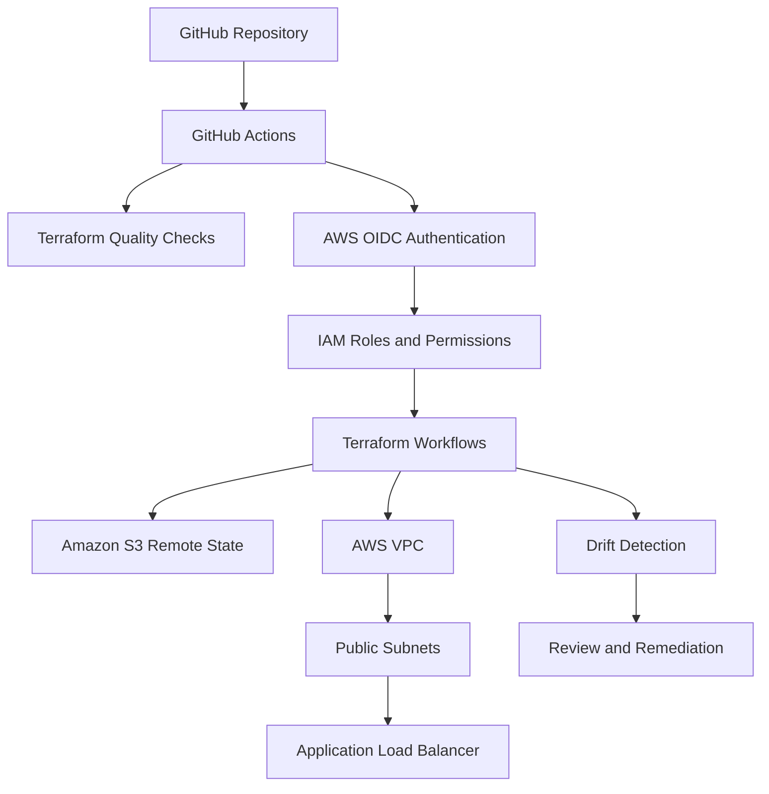

# 🎯 Operation GoldenEye

**A James Bond-inspired DevOps project demonstrating Infrastructure as Code, secure AWS authentication, automated deployment, infrastructure drift detection, and controlled teardown.**


## 🕵️ Mission briefing

**Mission:** Build and manage AWS infrastructure through a repeatable, security-conscious automation pipeline.

Operation GoldenEye explores how cloud infrastructure can be defined as code, checked automatically, deployed through GitHub Actions, monitored for unexpected changes, and removed through a controlled teardown process.

Terraform defines the infrastructure, while GitHub Actions uses AWS IAM OpenID Connect (OIDC) to obtain temporary credentials without storing long-lived AWS access keys in GitHub repository secrets.

**Infrastructure lifecycle:** Validate → Plan → Deploy → Detect drift → Remediate → Destroy

### Mission objectives

- Automate Terraform quality checks and configuration validation.
- Authenticate GitHub Actions to AWS using OIDC and IAM roles.
- Store Terraform state remotely in Amazon S3.
- Define AWS networking and an Application Load Balancer (ALB) using Terraform.
- Generate and review Terraform execution plans before deployment.
- Detect and investigate manual infrastructure changes.
- Verify remediation and clean up resources when the experiment is complete.
- Document implementation evidence through workflow and AWS screenshots.

## 🏗️ Architecture

The project connects source control, CI/CD automation, AWS identity, Terraform state, and cloud infrastructure.



### Architecture components

| Component | Purpose |
|---|---|
| GitHub repository | Stores Terraform configuration, workflow definitions, and documentation. |
| GitHub Actions | Automates quality checks, identity verification, planning, deployment, drift detection, and teardown. |
| AWS IAM OIDC provider | Establishes a trusted identity relationship with GitHub Actions. |
| IAM roles | Provide permissions for the relevant workflow responsibilities. |
| Terraform | Defines and manages infrastructure declaratively. |
| Amazon S3 | Stores remote Terraform state; the bucket is configured with versioning and Block Public Access. |
| Amazon VPC | Provides the project's virtual network. |
| Public subnets | Host the internet-facing load balancer across two Availability Zones. |
| Internet gateway and route table | Provide the routing required for public connectivity. |
| Security group | Controls traffic to the ALB. |
| Application Load Balancer | Exposes the demonstration endpoint over HTTP. |

### Network design

The Terraform configuration defines a VPC with CIDR range `10.70.0.0/16` and two public subnets across two available Availability Zones. An internet gateway and route table provide the route required for internet-facing connectivity.

The ALB security group permits inbound HTTP traffic on port 80. The ALB listener returns a fixed response rather than forwarding traffic to an application server:

> MI6 GOLDENEYE: Mission control is operational.

This keeps the demonstration focused on networking, identity, infrastructure automation, and lifecycle management without requiring an EC2 fleet or container platform.

## 🧰 Technology stack

- **Infrastructure as Code:** Terraform
- **Automation and CI/CD:** GitHub Actions
- **Cloud platform:** Amazon Web Services (AWS)
- **Authentication and access control:** AWS IAM and GitHub Actions OIDC
- **Networking:** Amazon VPC, subnets, internet gateway, route tables, and security groups
- **Traffic entry point:** Application Load Balancer
- **Remote state:** Amazon S3
- **Version control:** Git and GitHub
- **Operational testing:** Validation, execution plans, deployment runs, drift experiments, and teardown

## 🔐 Security design

### OIDC authentication

GitHub Actions assumes an AWS IAM role through OpenID Connect and receives temporary credentials. This avoids storing long-lived AWS access keys in GitHub repository secrets.

The OIDC trust policy should be restricted to the intended repository and GitHub environment, with audience and subject conditions that match the actual GitHub token claims.

### Role separation

The workflows have distinct responsibilities:

- **Identity verification:** Tests the GitHub-to-AWS trust relationship and confirms the AWS identity.
- **Deployment:** Performs infrastructure operations allowed by the deployment role.
- **Drift detection:** Reads the infrastructure and Terraform state needed to calculate a plan, including any required state-lock permissions.

Separate roles make permission boundaries easier to reason about, but do not guarantee least privilege by themselves. That depends on the effective IAM policies and trust conditions.

### Remote state protection

Amazon S3 stores Terraform state outside the GitHub Actions runner. The bucket is configured with:

- **Versioning** to preserve previous object versions.
- **Block Public Access** to reduce the risk of unintended public exposure.
- **Restricted access** through appropriate IAM permissions.

Terraform state may contain sensitive infrastructure metadata. Public-access protection does not replace access controls or appropriate encryption.

### Change control

Terraform plans should be reviewed before consequential changes are applied. GitHub environment protection rules can provide an approval gate when configured and tested. A manually triggered workflow does not automatically provide a separate approval step.

## ⚙️ Workflow evidence

The following screenshots document the project from quality checks and identity verification through deployment, drift detection, and cleanup.

### 1. Terraform quality checks

Automated checks help identify formatting and configuration issues before infrastructure changes are applied.


### 2. OIDC identity verification

The identity-check workflow verifies that GitHub Actions can authenticate to AWS and assume the expected IAM role. The resulting identity should be checked against the intended account and role.


### 3. S3 remote-state security

The S3 bucket stores Terraform state remotely. Versioning preserves previous object versions, while Block Public Access helps prevent unintended public exposure.


### 4. Terraform validation

After the VPC and ALB configuration was committed, the validation workflow checked the Terraform configuration for errors. Validation is an important quality gate, but does not guarantee that AWS will successfully create every resource.


### 5. Terraform plan

Terraform plan previews proposed infrastructure changes. Reviewing the plan helps identify unexpected creation, modification, or deletion before deployment.


### 6. Terraform plan and apply

The deployment workflow generates a plan and applies the proposed changes according to its configuration. Verify the resulting resources in AWS as well as the workflow result.


### 7. Infrastructure drift detection

Drift occurs when the real infrastructure differs from the configuration Terraform expects. The workflow runs a Terraform plan to identify differences and should distinguish between no changes, detected changes, and execution errors.

The workflow is configured for manual execution and a daily schedule at **08:17 UTC**.


A detected difference is a signal to investigate, not an instruction to apply changes automatically.

### 8. Deployment run

These screenshots provide additional evidence from the deployment process. The plan, workflow result, and AWS resources should be considered together when confirming what was deployed.


## 🧪 Controlled drift experiment

The drift experiment tests whether Terraform identifies a manual change made outside the normal infrastructure-as-code workflow.

### Procedure

1. Run a baseline plan and confirm there are no unexpected changes.
2. Change the ALB's `Owner` tag manually in AWS.
3. Run the drift-detection workflow.
4. Inspect the proposed Terraform changes and exit status.
5. Confirm whether Terraform proposes restoring the intended tag.
6. Remediate through an approved Terraform workflow.
7. Run the plan again to confirm the expected configuration is restored.

The intended tag is:

```hcl
Owner = "GoldenEye"
```

For the experiment, the value is changed to:

```hcl
Owner = "ManualChangeTest"
```

If Terraform manages this tag as expected, the plan should propose restoring `Owner = "GoldenEye"`. A result such as the following indicates one resource modification and no additions or deletions:

```text
Plan: 0 to add, 1 to change, 0 to destroy.
```

### Interpreting detailed exit codes

When Terraform plan uses `-detailed-exitcode`, the exit status has specific meanings:

| Exit code | Meaning |
|---|---|
| `0` | The plan succeeded and found no changes. |
| `1` | Terraform encountered an error. |
| `2` | The plan succeeded and found changes. |

The workflow should handle these outcomes explicitly. A detected change is not the same as an execution error, and a successful workflow step does not necessarily mean the infrastructure is drift-free.

### Experiment evidence


**Experiment result:** Use the workflow output to document what was detected and whether the follow-up plan was clean. Do not claim successful remediation unless the evidence confirms it.

## 🧹 Terraform destroy and cleanup

Teardown is part of the infrastructure lifecycle. Temporary resources should not be left running after the experiment is complete.

The destroy workflow should generate and display a destroy plan before the deletion operation is approved and executed. Afterward, verify the AWS resources directly; workflow success alone does not prove that every resource has been removed.

- Review the final workflow result.
- Check AWS for remaining resources.
- Investigate failed deletions or resources outside the selected Terraform state.
- Keep the S3 state backend available until it is safe to retire it separately.
- Review AWS billing for remaining or accumulated charges.

### Teardown evidence


## 💷 Cost management

This project is a focused demonstration, but live AWS deployment is **not automatically free**. A public Application Load Balancer can incur charges while it exists, even when it returns only a fixed response. S3 storage and requests, along with other resources, may also incur charges depending on usage and account eligibility.

Cost-control practices:

- Review the Terraform plan before deployment.
- Check AWS billing and any available budget alerts.
- Keep live resources only for as long as required.
- Run the approved teardown workflow when finished.
- Verify resource removal rather than relying solely on the workflow result.
- Retain the Terraform state backend until it is safe to remove.

**Cost status:** Confirm actual costs through AWS billing data. Do not claim zero cost unless the account's usage and billing evidence support it.

## 🛠️ Failure handling

| Scenario | Response |
|---|---|
| Terraform validation fails | Review the error and correct the configuration before deployment. |
| OIDC authentication fails | Check workflow permissions, audience, IAM trust conditions, and repository/environment identity. |
| The plan proposes unexpected changes | Stop before applying and investigate configuration, state, and proposed actions. |
| Drift is detected | Determine whether the change was intentional and remediate through an approved process. |
| Drift detection errors | Investigate credentials, permissions, state access, locking, and workflow logs. |
| Terraform apply fails | Check the AWS error and determine whether a partial deployment occurred. |
| Terraform destroy fails | Identify remaining resources, resolve permissions or dependency issues, and create a fresh plan before retrying. |

## 🚀 How to reproduce

### Prerequisites

- A GitHub repository containing the Terraform configuration and workflow files.
- An AWS account and deployment region.
- An AWS IAM OIDC provider configured for GitHub Actions.
- IAM roles with appropriate trust policies and permissions.
- An S3 Terraform backend configured with the expected bucket, key, region, and state-lock mechanism.
- GitHub environment variables containing the required role ARNs.
- GitHub environment protection rules, if approval gates are required.

### Workflow sequence

1. Review the repository and Terraform configuration.
2. Run Terraform quality checks.
3. Run the OIDC identity-check workflow.
4. Verify S3 versioning and Block Public Access.
5. Commit the VPC and ALB configuration.
6. Run Terraform validation.
7. Generate and review a Terraform plan.
8. Execute the approved deployment workflow.
9. Verify the AWS resources.
10. Run drift detection and perform the manual-tag experiment.
11. Restore the intended configuration and confirm the follow-up plan.
12. Run teardown when the infrastructure is no longer required.
13. Verify cleanup and review billing.

Always confirm the AWS account, region, backend, and proposed plan before deployment or destructive operations.

## ⚠️ Scope and limitations

- The ALB returns a fixed HTTP response rather than serving a full application.
- HTTPS, a custom domain, and an application server fleet are outside the scope of this implementation.
- Terraform validation does not guarantee successful deployment or secure runtime configuration.
- Drift detection identifies differences; it does not decide whether a manual change is authorised.
- Role separation supports least privilege only when effective policies enforce appropriate restrictions.
- Terraform destroy removes resources managed by the selected state and permitted by AWS; it is not a general account-cleanup mechanism.
- Actual costs, deployment outcomes, and cleanup results must be verified in the AWS account.

## 📚 Key lessons

- **Identity before automation:** CI/CD needs a trusted, appropriately restricted identity.
- **Infrastructure as Code:** Declarative configuration makes infrastructure changes repeatable and reviewable.
- **State matters:** Remote state is central to Terraform's view of managed infrastructure.
- **Plans are decision points:** Reviewing changes reduces the risk of accidental modifications.
- **Drift requires investigation:** Unexpected changes must be detected, understood, and remediated.
- **Least privilege is operational:** Each workflow should have only the permissions it needs.
- **Cleanup is part of delivery:** Teardown and verification matter as much as deployment.
- **Evidence builds confidence:** Workflow logs and AWS configuration screenshots help demonstrate what was tested.

## 🎯 Final mission status

Operation GoldenEye brings together Terraform, GitHub Actions, AWS OIDC, remote state, networking, deployment, drift detection, and controlled teardown.

The goal is not simply to make infrastructure work. It is to make the lifecycle **repeatable, observable, security-conscious, and reversible**.

*Mission objective: automate responsibly, investigate unexpected changes, and leave no unnecessary infrastructure running.*
