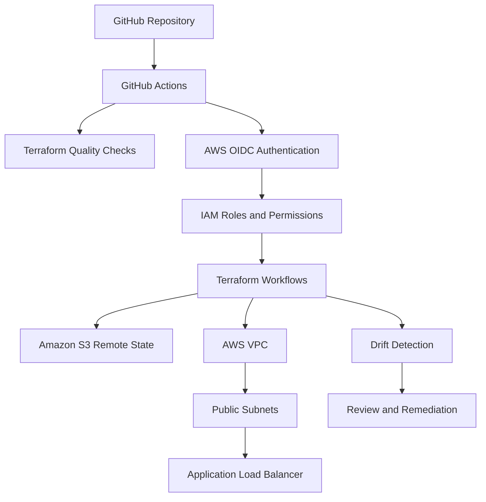

# 🎯 Operation GoldenEye

**A James Bond-inspired DevOps project demonstrating Terraform, GitHub Actions, AWS OIDC authentication, secure remote state, infrastructure deployment, drift detection, and controlled teardown.**


## 🕵️ Mission briefing

**Mission:** Build and manage AWS infrastructure through a repeatable, security-conscious automation pipeline.

Operation GoldenEye is a hands-on DevOps project exploring how cloud infrastructure can be defined as code, validated automatically, deployed through GitHub Actions, monitored for unexpected changes, and removed through a controlled teardown process.

The project uses Terraform to define infrastructure and AWS IAM OpenID Connect (OIDC) to authenticate GitHub Actions to AWS without storing long-lived AWS access keys in GitHub repository secrets.

Rather than focusing solely on deployment, this project covers the infrastructure lifecycle:

**Validate → Plan → Deploy → Detect drift → Remediate → Destroy**

### Mission objectives

- Automate Terraform quality checks and configuration validation.
- Configure GitHub Actions to authenticate to AWS using OIDC.
- Store Terraform state remotely in Amazon S3.
- Apply IAM permissions appropriate to different workflow responsibilities.
- Provision AWS networking and an Application Load Balancer (ALB).
- Generate and review Terraform execution plans.
- Introduce and detect infrastructure drift.
- Restore the intended configuration and verify the result.
- Document implementation evidence and resource cleanup.

## 🏗️ Architecture

The project connects source control, CI/CD automation, AWS identity, Terraform state, and cloud infrastructure.



### Architecture components

| Component | Purpose |
|---|---|
| GitHub | Stores Terraform configuration, workflow definitions, and documentation. |
| GitHub Actions | Automates quality checks, identity verification, planning, deployment, drift detection, and teardown. |
| AWS IAM OIDC provider | Establishes a trusted identity relationship with GitHub Actions. |
| IAM roles | Grant permissions to the relevant workflow operations. |
| Terraform | Defines and manages the infrastructure declaratively. |
| Amazon S3 | Stores remote Terraform state, with versioning and Block Public Access configured on the state bucket. |
| Amazon VPC | Provides the project's virtual network. |
| Public subnets | Place the public-facing load balancer across two Availability Zones. |
| Internet gateway and route table | Provide the routing needed for internet-facing connectivity. |
| Security group | Controls inbound and outbound traffic to the load balancer. |
| Application Load Balancer | Provides a public HTTP endpoint for the demonstration. |

### Network design

The Terraform configuration defines a VPC using the CIDR range `10.70.0.0/16`, with two public subnets across the first two available Availability Zones.

An internet gateway and route table provide the required internet route. The ALB security group permits inbound HTTP traffic on port 80.

The ALB uses a fixed-response listener rather than an application server. Its demonstration response is:

> MI6 GOLDENEYE: Mission control is operational.

This keeps the demonstration focused on networking, infrastructure automation, authentication, and lifecycle management without requiring an EC2 fleet or container platform.

## 🧰 Technology stack

- **Infrastructure as Code:** Terraform
- **Automation and CI/CD:** GitHub Actions
- **Cloud platform:** Amazon Web Services (AWS)
- **Authentication:** GitHub Actions OIDC and AWS IAM
- **Networking:** Amazon VPC, subnets, internet gateway, route tables, and security groups
- **Traffic entry point:** Application Load Balancer
- **Remote state:** Amazon S3
- **Version control:** Git and GitHub
- **Operational testing:** Terraform validation, execution plans, deployment runs, drift experiments, and teardown

## 🔐 Security and identity

### OIDC authentication

GitHub Actions authenticates to AWS using OpenID Connect and assumes an IAM role to obtain temporary credentials.

This avoids the need to store long-lived AWS access keys in GitHub repository secrets.

The trust policy should restrict access to the intended repository and GitHub environment, with the correct token audience and subject conditions. The IAM role's permissions should also be limited to the operations required by its workflow.

### Role separation

The project distinguishes between three workflow responsibilities:

- **Identity verification:** Confirms that GitHub Actions can authenticate to AWS using the configured trust relationship.
- **Deployment:** Performs the Terraform operations permitted by the deployment role.
- **Drift detection:** Reads the infrastructure and Terraform state needed to identify differences, with any necessary state-lock permissions.

Separate roles support clearer permission boundaries, but least privilege depends on the actual policies attached to those roles.

### Remote state security

Amazon S3 stores Terraform state outside the ephemeral GitHub Actions runner.

The state bucket is configured with:

- **Versioning** to preserve previous object versions and support recovery.
- **Block Public Access** to help prevent unintended public exposure.
- **Restricted access** through appropriate AWS permissions.

Terraform state can contain sensitive infrastructure metadata. Public-access protection alone is not sufficient; access control and appropriate encryption are also important.

### Change control

Deployment and teardown should be deliberate operations. Terraform plans must be reviewed before consequential changes are applied.

GitHub environment protection rules can provide an approval gate when configured. A manually triggered workflow is not, by itself, proof that a separate approval step exists.

## ⚙️ Automated workflows

The GitHub Actions workflows demonstrate different stages of the infrastructure lifecycle.

### 1. Terraform quality checks

Automated checks help identify formatting, configuration, and validation issues before deployment.

**Evidence**


*GitHub Actions running the Terraform quality-check workflow.*

### 2. OIDC identity verification

The identity-check workflow tests the GitHub-to-AWS authentication configuration. The resulting AWS identity should match the expected account and IAM role.

**Evidence**


*Evidence of the workflow's AWS identity verification.*

### 3. Secure S3 remote state

The S3 state bucket keeps Terraform state outside the GitHub Actions runner. Versioning helps preserve state history, while Block Public Access reduces the risk of unintended public exposure.

**Evidence**


*Amazon S3 bucket configuration showing versioning and Block Public Access settings.*

### 4. Terraform validation

After the VPC and ALB configuration was committed, the validation workflow checked the Terraform configuration for errors.

Validation is an important quality gate, although it does not guarantee that AWS will successfully create every resource.

**Evidence**


*Terraform validation following the infrastructure configuration changes.*

### 5. Terraform plan

The plan workflow previews the infrastructure changes Terraform proposes to make.

Reviewing the plan helps identify unexpected resource creation, modification, or deletion before deployment.

**Evidence**


*Terraform's proposed infrastructure changes before deployment.*

### 6. Terraform plan and apply

The deployment workflow generates a Terraform plan and applies the proposed changes according to the workflow configuration.

The resulting infrastructure should be verified in AWS rather than relying on the workflow status alone.

**Evidence**


*Evidence from the Terraform plan-and-apply workflow.*

### 7. Infrastructure drift detection

Infrastructure drift occurs when the real infrastructure differs from the configuration Terraform expects.

The drift workflow runs a Terraform plan to identify differences between the declared configuration, Terraform state, and infrastructure observed in AWS.

The workflow supports manual execution and is configured to run daily at **08:17 UTC**.

A detected difference should be investigated before remediation. Drift detection does not automatically determine whether a manual change was legitimate.

**Evidence**


*GitHub Actions evidence from the infrastructure drift-detection workflow.*

### 8. Running a deployment

This stage documents the deployment run and provides evidence of the infrastructure lifecycle in action.

The plan, workflow result, and AWS resources should be checked together to establish what was actually deployed.

**Evidence**


*Evidence from the infrastructure deployment workflow.*

## 🧪 Controlled drift experiment

The drift experiment tests whether Terraform can identify a manual change made outside the normal infrastructure-as-code workflow.

### Experiment procedure

1. Establish a baseline by running Terraform plan with no unexpected changes.
2. Change the ALB's `Owner` tag manually in AWS.
3. Run the drift-detection workflow.
4. Inspect the Terraform plan and its exit status.
5. Confirm whether Terraform proposes restoring the intended configuration.
6. Restore the expected configuration through an approved Terraform workflow.
7. Run drift detection again to check whether the plan is clean.

### Expected configuration difference

The intended tag is:

```hcl
Owner = "GoldenEye"
```

The experiment changes the tag to:

```hcl
Owner = "ManualChangeTest"
```

Terraform should identify the difference and, if the resource and tag remain managed as expected, propose restoring `Owner = "GoldenEye"`.

A plan showing the following would indicate one resource modification and no additions or deletions:

```text
Plan: 0 to add, 1 to change, 0 to destroy.
```

### Interpreting Terraform's detailed exit codes

When Terraform plan runs with `-detailed-exitcode`, its result can be interpreted as follows:

| Exit code | Meaning |
|---|---|
| `0` | The plan succeeded and found no changes. |
| `1` | Terraform encountered an error. |
| `2` | The plan succeeded and identified changes. |

The workflow must handle these outcomes explicitly. A detected change is not the same as an execution failure, and a successful workflow step does not necessarily mean the infrastructure is drift-free.

### Experiment evidence


*Evidence from the intentional manual-change experiment and the resulting drift-detection run.*

**Result:** Record the actual outcome shown by your workflow. A strong result demonstrates the baseline, the detected difference, and the clean plan after remediation.

## 🧹 Terraform destroy and cleanup

Teardown is an important part of the infrastructure lifecycle. Temporary cloud resources should not be left running simply because the deployment experiment has finished.

The teardown workflow generates and reviews a Terraform destroy plan before carrying out the configured deletion operation.

After teardown:

- Review the final workflow result.
- Check AWS for resources that may remain.
- Investigate failed deletions or resources outside the selected Terraform state.
- Keep the S3 state backend available until it is safe to retire it separately.
- Review AWS billing for any remaining or accumulated charges.

A successful destroy workflow does not, by itself, prove that every resource in the AWS account has been removed.

**Evidence**


*Terraform teardown workflow evidence. Confirm the final deletion result and AWS cleanup separately.*

## 💷 Cost management

Operation GoldenEye is a focused demonstration, but a deployment is **not automatically free**.

A public Application Load Balancer can incur charges while it exists, even if it returns only a fixed response. Other resources and S3 storage or requests may also incur charges depending on usage and account eligibility.

Cost-control measures include:

- Reviewing the proposed Terraform plan before deployment.
- Checking the AWS billing console and any available budget alerts.
- Keeping live infrastructure only for as long as required.
- Running the approved teardown workflow when the experiment is complete.
- Verifying that resources have actually been removed.
- Retaining the Terraform state backend until it is safe to remove.

**Cost status:** Confirm actual costs using AWS billing data. Do not describe the project as zero-cost unless the account's actual usage and billing evidence support that claim.

## 🛠️ Failure handling

| Scenario | Operational response |
|---|---|
| Terraform validation fails | Review the configuration error and correct it before deployment. |
| OIDC authentication fails | Check workflow permissions, token audience, IAM trust conditions, and repository/environment identity. |
| Terraform plan proposes unexpected changes | Stop before applying and investigate the configuration, state, and proposed actions. |
| Drift is detected | Determine whether the manual change was intentional and remediate through an approved process. |
| Drift detection encounters an error | Investigate credentials, permissions, state access, locking, and workflow logs. |
| Terraform apply fails | Inspect the AWS error and determine whether some resources were created or modified before failure. |
| Terraform destroy fails | Identify remaining resources, investigate permissions or dependencies, and generate a fresh plan before retrying. |

## 🚀 How to reproduce

### Prerequisites

- A GitHub repository containing the Terraform configuration and workflow files.
- An AWS account and selected region.
- An AWS IAM OIDC provider configured for GitHub Actions.
- IAM roles with suitable trust policies and permissions.
- An S3 Terraform backend configured for the expected bucket, key, region, and state-lock mechanism.
- GitHub environment variables containing the correct IAM role ARNs.
- Appropriate GitHub environment protection rules, if approval gates are required.

### Workflow sequence

1. Review the repository structure and Terraform configuration.
2. Run Terraform quality checks.
3. Run the OIDC identity-check workflow.
4. Verify the S3 bucket's versioning and Block Public Access settings.
5. Commit the VPC and ALB configuration.
6. Run Terraform validation.
7. Generate and review a Terraform plan.
8. Execute the approved deployment workflow.
9. Verify the resulting AWS resources.
10. Run drift detection and perform the controlled manual-tag experiment.
11. Restore the expected configuration and confirm the resulting plan.
12. Execute teardown when the infrastructure is no longer required.
13. Verify cleanup and review billing.

Always verify the AWS account, region, Terraform backend, and proposed changes before running deployment or destructive operations.

## ⚠️ Scope and limitations

- The ALB returns a fixed HTTP response rather than serving a full application.
- HTTPS, a custom domain, and an application server fleet are outside the scope of this implementation.
- Terraform validation does not guarantee successful deployment or secure runtime configuration.
- Drift detection identifies differences; it does not independently decide whether a change is authorised.
- IAM role separation supports least privilege only when the attached policies enforce suitable restrictions.
- Terraform destroy operates on resources managed by the selected state and permitted by AWS; it is not a general account-cleanup mechanism.
- Actual costs, deployment outcomes, and cleanup results must be verified against the AWS account.

## 📚 Key lessons

Operation GoldenEye explores several practical DevOps principles:

- **Identity before automation:** CI/CD requires a trusted, appropriately restricted identity.
- **Infrastructure as Code:** Declarative configuration makes infrastructure changes repeatable and reviewable.
- **State matters:** Remote state is central to tracking and managing Terraform resources.
- **Plans are decision points:** Reviewing proposed changes reduces the risk of accidental modifications.
- **Drift requires investigation:** Unexpected changes need to be detected, understood, and remediated.
- **Least privilege is operational:** Permissions should reflect what each workflow actually needs to do.
- **Cleanup is part of delivery:** Teardown and verification are as important as deployment.
- **Evidence builds confidence:** Workflow logs and AWS configuration screenshots make the implementation easier to assess.

## 🎯 Final mission status

Operation GoldenEye brings together Terraform, GitHub Actions, AWS OIDC, remote state, networking, infrastructure deployment, drift detection, and controlled teardown.

The objective is not simply to make infrastructure work. It is to make the lifecycle **repeatable, observable, security-conscious, and reversible**.

*Mission objective: automate responsibly, investigate unexpected changes, and leave no unnecessary infrastructure running.*
